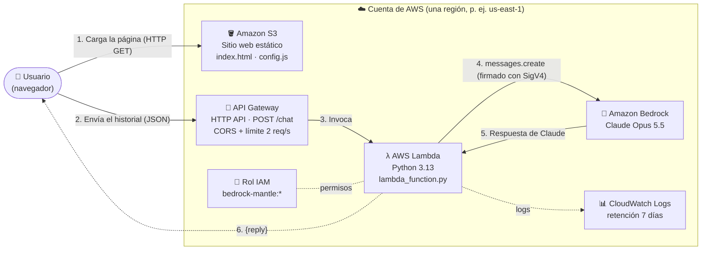

# Chat IA en AWS (Amazon Bedrock + Serverless)

Aplicación web de chat que responde con **Claude Opus 5.5 en Amazon Bedrock**.

## Arquitectura



**Flujo de una petición**

1. El navegador descarga `index.html` y `config.js` desde el bucket S3, que está configurado como sitio web.
2. Cuando el usuario envía un mensaje, la página hace un `POST /chat` a API Gateway con el historial de la conversación.
3. API Gateway aplica CORS y el límite de tráfico, y luego invoca la Lambda.
4. La Lambda valida el historial y llama a Claude en Bedrock con el SDK `anthropic`. Se autentica con las credenciales de su rol IAM.
5. La Lambda devuelve el texto de la respuesta al navegador, que lo muestra en el chat.

Todos los recursos, salvo el bucket del código de la Lambda, se crean con [infra/template.yaml](infra/template.yaml).

| Carpeta / archivo | Qué contiene |
|---|---|
| `backend/lambda_function.py` | Lambda que valida el historial y llama a Claude con el SDK `anthropic` (`AnthropicBedrockMantle`) |
| `frontend/index.html`, `frontend/config.js` | Interfaz de chat (HTML + JS, sin dependencias) |
| `infra/template.yaml` | Plantilla de CloudFormation: Lambda, rol IAM, API Gateway, bucket S3 del sitio |
| `build.ps1` | Empaqueta la Lambda con sus dependencias en `dist/lambda.zip` |

## Costos

| Servicio | Capa gratuita | Notas |
|---|---|---|
| Lambda | 1 millón de invocaciones/mes (siempre gratis) | Sobra para pruebas |
| API Gateway HTTP API | 1 millón de llamadas/mes (12 meses) | Limitada a 2 req/s (ráfagas de 5) para evitar abusos |
| S3 | 5 GB y 20.000 GET/mes (12 meses) | |
| CloudWatch Logs | 5 GB/mes | Los logs se guardan 7 días |
| **Bedrock (Claude)** | **No es gratis** | Se cobra por token. Consulta https://aws.amazon.com/bedrock/pricing/ |

> 💡 Crea una **alerta de presupuesto** en *Billing → Budgets* (por ejemplo, de 5 USD) antes de publicar la URL.
> La API es pública: cualquiera que tenga la URL puede gastar tokens.

## Despliegue (desde la consola de AWS, sin CLI)

### 1. Activa el modelo en Bedrock
1. Abre la consola de **Amazon Bedrock** en la región que vas a usar (por ejemplo, `us-east-1`).
2. Ve a **Model access** / **Model catalog**, busca **Claude Opus 5.5** y solicita acceso si te lo pide.

### 2. Empaqueta la Lambda
```powershell
.\build.ps1
```
Esto genera `dist\lambda.zip`, de unos 31 MB.

### 3. Sube el zip a S3
1. En **S3**, crea un bucket en **la misma región**, por ejemplo `chat-ia-codigo-<tu-nombre>`.
2. Sube `dist\lambda.zip` a ese bucket.

### 4. Crea el stack de CloudFormation
1. En **CloudFormation**, entra en **Create stack → With new resources** y sube `infra\template.yaml`.
2. Parámetros:
   - `CodeBucket`: el bucket del paso 3.
   - `CodeKey`: `lambda.zip`.
   - Deja los demás valores por defecto.
3. Marca la casilla *I acknowledge that AWS CloudFormation might create IAM resources* y crea el stack.
4. Cuando el stack llegue a `CREATE_COMPLETE`, abre la pestaña **Outputs** y apunta `ApiUrl`, `WebsiteBucketName` y `WebsiteUrl`.

### 5. Publica el frontend
1. Edita `frontend\config.js` y pega el valor de `ApiUrl`.
2. Sube `index.html` y `config.js` al bucket `WebsiteBucketName`.
3. Abre `WebsiteUrl` en el navegador.

### 6. (Recomendado) Restringe CORS
Actualiza el stack (*Update → Use current template*) y cambia `AllowedOrigin` por el valor de `WebsiteUrl`, por ejemplo `http://xxx.s3-website-us-east-1.amazonaws.com`. Así, otras páginas web no podrán llamar a tu API desde el navegador.

## Configuración

Las siguientes variables de entorno de la Lambda se pueden cambiar en la consola, en *Lambda → Configuration → Environment variables*:

| Variable | Por defecto | Uso |
|---|---|---|
| `MODEL_ID` | `anthropic.claude-opus-5-5` | Modelo de Claude en Bedrock |
| `EFFORT` | `low` | `low` / `medium` / `high`: un valor más alto da respuestas más elaboradas, pero gasta más tokens |
| `MAX_TOKENS` | `4096` | Longitud máxima de la respuesta |
| `MAX_HISTORY` | `20` | Número de mensajes del historial que se envían al modelo |
| `MAX_CHARS` | `4000` | Tamaño máximo de cada mensaje del usuario |
| `SYSTEM_PROMPT` | Asistente amable | Personalidad e instrucciones del bot |

## Solución de problemas

- **"La función no tiene acceso al modelo en Bedrock"**: revisa que tengas acceso al modelo (paso 1) y que la región del stack sea la misma en la que lo activaste.
- **Error de CORS en el navegador**: revisa que `AllowedOrigin` sea `*` o coincida exactamente con la URL del sitio.
- **"Falta configurar CHAT_API_URL"**: no actualizaste `config.js`, o no lo volviste a subir a S3.
- **Logs**: los encontrarás en *CloudWatch → Log groups → /aws/lambda/<nombre-de-la-función>*.

## Actualizar el código
Ejecuta `.\build.ps1` y sube el nuevo `lambda.zip` desde *Lambda → Code → Upload from → .zip file*, o súbelo a S3 y actualiza el stack.
